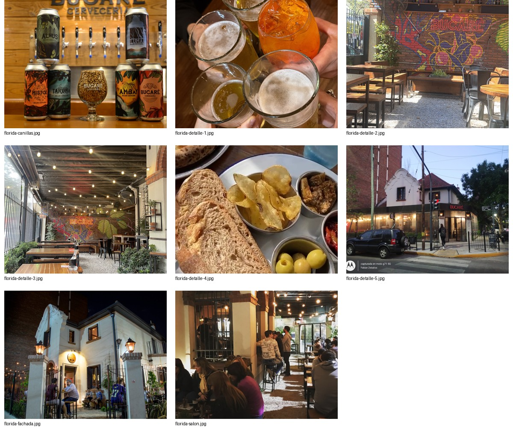

# Bucaré Cervecería: relevamiento del negocio y base para una web propia

**Fecha de consulta: 2 de noviembre de 2026.** Investigación de fuentes públicas, no auditoría interna. Destino: selección de identidad y preparación de una web que reemplace Linktree.

## 1. Alcance y certeza

Este informe reúne todo lo recuperado de las fuentes indicadas, con sus originales y anexos. No sería correcto prometer «toda la información sin excepciones»: Instagram restringe el feed y Google Maps entrega una vista limitada. No se descargaron las 487 publicaciones ni las 1.169 fotos anunciadas por Maps. Se conservan los cuatro documentos completos de Linktree, los siete enlaces comerciales, ambos avatars publicados, los metadatos públicos de Instagram, ocho fotos de Florida y el material accesible de las seis referencias.

**Publicado** significa que aparece en una fuente; no garantiza que siga vigente. **Observado** describe una imagen. **Propuesto** es una decisión de diseño. **Pendiente** exige confirmación del negocio.

Las cartas están fechadas en sus metadatos el 28/10/2026. Esa fecha es de generación del archivo, no de inicio o fin de vigencia de sus precios. Todos los precios se conservaron con el símbolo `$`; pesos argentinos es la interpretación contextual, no una moneda expresamente rotulada en las páginas leídas.

## 2. Identificación y presencia digital

| Campo | Información recuperada | Fuente |
| --- | --- | --- |
| Nombre visible | Bucaré Cervecería | Logos, cartas y Maps |
| Instagram | [@bucarecerveceria](https://www.instagram.com/bucarecerveceria/) | URL aportada y metadatos |
| Seguidores | «16K», cifra redondeada, no 16.000 exactos | Metadatos Instagram |
| Cuentas seguidas | 751 | Metadatos Instagram |
| Publicaciones anunciadas | 487; contenido completo no accesible | Metadatos Instagram |
| Concentrador actual | [linktr.ee/bucarecerveceria](https://linktr.ee/bucarecerveceria) | Fuente primaria |
| Descripción propia en Linktree | Vacía/null en los datos estructurados | HTML archivado |
| Alta en Linktree | Julio de 2022, según la biografía automática de la plataforma | No confundir con fundación del negocio |
| Web indicada por Maps Florida | Instagram | Ficha consultada |
| Dominio propio | No identificado en las fuentes relevadas | No equivale a afirmar que no existe |

Biografía pública recuperada literalmente:

> 🏭 BrewPub. Ugarte 2328 Olivos  
> 🏡 BucaFlori. San Martin 2800 Florida  
> 🚊 BucaTren. Av Maipu 2298 Plaza de los Inmigrantes  
> 📞Reservas y menu en el link

Los alias sirven para conservar continuidad entre Instagram y la futura web. «Bucafé» aparece en las cartas: es una línea de cafetería publicada, no una cuarta sucursal.

## 3. Sucursales y reservas

| Sucursal | Dirección publicada | Contacto de reservas | Carta |
| --- | --- | --- | --- |
| Florida / BucaFlori | Av. San Martín 2800, Florida | [+54 9 11 4196-6543](https://wa.me/5491141966543) | [Original Florida](../investigacion/originales/menu-florida.pdf) |
| Olivos / Brew Pub / BrewPub | Gob. Ugarte 2328, Olivos | [+54 9 11 2326-6242](https://wa.me/5491123266242) | [Original Olivos](../investigacion/originales/menu-olivos.pdf) |
| Tren / BucaTren | Av. Maipú 2298, Plaza de los Inmigrantes, Olivos | [+54 9 11 6568-6545](https://wa.me/5491165686545) | [Original Tren](../investigacion/originales/menu-tren.pdf) |

La asociación de Brew Pub con Ugarte está confirmada por Instagram y por el encabezado de la carta de Olivos. No es una suposición a partir del orden de botones.

Para Florida, Maps amplía la dirección a **Gral. José de San Martín 2800, B1602DFR Florida, Provincia de Buenos Aires**, coordenadas **-34.5316847, -58.4992896**, código **FG92+87**. [Ficha de Florida](https://www.google.com/maps?cid=1243224865490914839). El enlace corto aportado abre esta sucursal; no ofrece evidencia directa de los otros dos interiores.

No se enviaron mensajes ni se comprobaron respuestas de los números. Son enlaces de reservas publicados, no teléfonos verificados mediante contacto. No publicar un único WhatsApp indiferenciado: cada sucursal necesita su destino.

## 4. Horarios y promociones: todas las condiciones recuperadas

| Oferta | Publicado | No publicado / pendiente |
| --- | --- | --- |
| Happy hour | Todos los días, de 18 a 20 h, todos los estilos, válido en los tres locales | Precio reducido, porcentaje, modalidad, acumulación |
| Efectivo | -10 % en la primera página de cada carta | Acumulación y excepciones |
| Cumpleaños | Con DNI, dentro de la semana del cumpleaños | Alcance por sucursal, definición de semana, acompañantes, reserva y mínimo |
| Latas | 6 latas: -20 %; 12 latas: -30 %; tres locales | Estilos combinables, precio final, stock, retiro/envío y acumulación |
| Menú ejecutivo | Bebida y café jarrito; válido de 10 a 18 h | Días de la semana y cambios por sucursal |
| Menú infantil | Bebida; válido de 10 a 18 h | Días, edades y cambios por sucursal |
| Burger + birra | $17.800; burger simple, cheddar, salsa americana; cerveza a elección o gaseosa; no incluye papas | Horario, estilos exceptuados y acumulación |

**No anunciar happy hour como 2x1.** Las fuentes no lo dicen. Tampoco sumar matemáticamente el descuento en efectivo a otras promociones sin confirmación.

### Cumpleaños: lista íntegra de precios

Costanera, Ambay, Luma y Mistol: **$5.500**. La lámina no especifica volumen o presentación.

| Producto | Precio |
| --- | ---: |
| Nachos power | $24.600 |
| Nachos veggie | $22.100 |
| Papas fritas | $15.600 |
| Papas parmesano | $17.500 |
| Pizza Mozza | $19.800 |
| Pizza cuatro quesos | $23.600 |
| Pizza napolitana | $21.700 |

Se conserva la [transcripción completa de las tres láminas](../investigacion/textos/promos-transcripcion.md) y el [PDF de promociones](../investigacion/originales/promos.pdf).

### Horarios del local

Maps mostró «Abierto · Cierra a la 1 a.m.» al consultar Florida. El despliegue semanal no resultó recuperable de forma fiable. No tomar esa frase dinámica como calendario semanal; tampoco el horario 10-18 de una oferta como horario de apertura. Horarios por día y feriados de las tres sucursales: pendientes.

## 5. Oferta cervecera completa

Precios de carta publicados. «—» reproduce un guion de la fuente: **precio no informado**, no «gratis», «agotado» ni «disponible». Las columnas de lata indican 473 cc. Las cartas imprimen 453 cc en algunas descripciones de APA/IPA; se conserva esa diferencia sin corregirla silenciosamente.

| Cerveza / estilo | Volumen en descripción | Alcohol publicado | Pinta | Lata | Perfil publicado |
| --- | --- | --- | ---: | ---: | --- |
| Buca Cero / rubia sin alcohol | No indicado en descripción | «Sin Alc.»; sin porcentaje | $7.300 | — | Dorada, suave, refrescante, cuerpo liviano, final limpio, amargor bajo |
| Costanera / Lager | 473 cc | 4,0 | $7.300 | $7.300 | Refrescante y de gran tomabilidad |
| Timbó / Nitro Porter | 473 cc | 6,2 | $7.700 | $8.000 | Oscura, nitrogenada, cremosa; chocolate y café |
| Ambay / Blond Ale | 473 cc | 4,5 | $7.300 | $7.300 | Rubia clásica; notas suaves a malta pilsen |
| Luma / Irish Red | 473 cc | 4,4 | $7.300 | $7.300 | Ámbar; caramelo y toffee |
| Mistol / Honey | 473 cc | 5,3 | $7.300 | $7.300 | Dorada, miel pampeana, dulce balance |
| Misterio de Pirlone / Kettle Sour | 400 cc | 3,6 | Florida y Olivos: —; Tren: $8.500 | — | Levemente ácida; frambuesa, mora y maracuyá |
| Alnus / APA | 453 cc | 5,2 | $7.700 | $8.000 | Cítrica, tropical; Cashmere y Centennial |
| Vicente Lopez / APA | 453 cc | 6,6 | $7.700 | $8.000 | Candy sugar y Citra; frutas de carozo y tropicales |
| Tarumá / American IPA | 453 cc | 6,2 | $8.500 | $9.000 | Tropicales y cítricas; Mosaic y Simcoe |
| Nostalgia de Verano / Session IPA | 453 cc | 3,8 | $8.500 | $9.000 | Suave, refrescante; aromas cítricos y frutales de Sabro |
| Fin del Milenio / NEIPA | 400 cc | 6,3 | — | — | Lúpulo, aroma y sabor; Mosaic e Idaho 7 |

Las fuentes usan la notación «alc»; interpretarla como porcentaje requiere validación editorial con la cervecería. No hay valores IBU ni confirmación de elaboración propia para cada etiqueta. El nombre BrewPub y las imágenes de canillas no prueban por sí solos quién fabrica todas las cervezas ni dónde.

## 6. Cocina, bebidas y Bucafé: cobertura íntegra

La oferta no se limita a cerveza y hamburguesas. Las cartas incluyen estas secciones, conservadas **sin recortes** en [Cartas completas](02-cartas-completas.md):

| Sección | Todos los productos recuperados |
| --- | --- |
| Para picar | Papas fritas; papas parmesano; empanadas de roast beef, fritas, 2 unidades; provoleta; chicken fingers; bocconcinos; hongos confitados; nachos power; nachos veggie |
| Pizzas, 30 cm / 6 porciones | Mozza; napolitana; cuatro quesos; provo jamón y morrón; portobello |
| Ensaladas | Hummus; hongos |
| Tartas | Jamón y queso; espinaca y ricota; con ensalada |
| Hamburguesas | Promo burger + birra; classic bacon y cheddar; tasty; roque |
| Entre panes | Pollo crispy; seta crispy; camembert |
| Platos | Milanesa de pollo; milanesa de bife de chorizo; estofado de ternera con ñoquis; ñoquis de ricota |
| Postres | Brownie con helado; crumble con helado |
| Ejecutivo | Mozza; milanesa de pollo; milanesa de bife de chorizo; las dos tartas; las dos ensaladas; ñoquis de ricota. Todos con bebida y café jarrito |
| Infantil | Chicken con fritas; hamburguesa con fritas. Ambos con bebida |
| Tragos y espumante | Fernet; tinto de verano; vermouth; gin tonic Beefeater; gin tonic Blu Gin; Garibaldi; Cynar Julep; Aperol Spritz; mojito; caipiroska Absolut; caipiroska Sernova; negroni; whisky Jameson con coca; cuba libre; Trumpeter Extra Brut 750 cc |
| Vinos | Malbec Fabre Montmayou Reserva; Malbec Cafayate Reserva-Etchart; copa Malbec; Cabernet Franc Trumpeter-Rutini; Pinot Noir Reserva-Salentein; rosado Amalaya Reserva; Chardonnay Killka-Salentein; copa Chardonnay |
| Otras bebidas | Agua; agua con gas; gaseosas Coca Cola, Coca Zero, Sprite, Sprite Zero y tónica; limonada; pomelada; jugo de naranja; licuados de frutilla, mango y banana |
| Bucafé, café y calientes | Espresso; americano; cortado; café con leche; latte; capuccino; iced latte; «Espresoo tonic» tal como figura; extras vainilla, caramelo y crema; submarino; té |
| Bucafé, dulce y salado | Tostadas palta y huevo; tostadas hummus; plato desayuno/merienda; tostado JyQ en molde con semillas o ciabatta, huevo revuelto opcional; tostadas; brownie sin helado; crumble de manzana; medialuna; medialuna JyQ; budín carrot; budín limón y arandano |
| Bucafé, combos | 1: dos medialunas; 2: tostado; 3: tostadas; 4: budín; 5: brownie o crumble; 6: dos medialunas JyQ; 7: plato desayuno/merienda; 8: tostadas palta y huevo; 9: tostadas hummus. Todos vienen con latte en taza |

El anexo contiene **todos los precios, ingredientes, bebidas incluidas, notas vegetarianas y presentaciones**, separado por sucursal y página. Los originales resuelven cualquier ambigüedad de extracción.

«v» significa **vegetariano**, según la leyenda. No equivale a vegano, sin TACC, apto celíacos, libre de alérgenos ni ausencia de contaminación cruzada. Hummus, nachos veggie y seta crispy llevan ingredientes lácteos en las descripciones publicadas. No promocionarlos como veganos.

Hay productos llamados brownie y crumble tanto en postres como en Bucafé, pero con presentaciones y precios diferentes. Tampoco juntar los precios de ejecutivo con los platos de carta. Las marcas distintas de gin tonic y caipiroska deben conservarse como opciones diferentes.

## 7. Google Maps Florida: reputación y límites

| Dato observado | Valor al consultar |
| --- | --- |
| Nombre de ficha | Cervecería Bucaré Florida |
| Categoría | Cervecería al aire libre |
| Valoración | 4,3/5 |
| Opiniones | 3.274 |
| Fotos anunciadas | 1.169 |
| Distribución de estrellas en vista recuperada | 5: 1.826; 4: 895; 3: 351; 2: 106; 1: 96 |
| Teléfono en ficha | La vista invita a agregar número; reservas sí están publicadas en Linktree |
| Etiquetas de opiniones | Carta 77; cerveza artesanal 60; ambientación 60; buena birra 40; otras no desplegadas |

La distribución recuperada suma 3.274. No se extrapola a Brew Pub ni Tren. Las opiniones son testimonios de terceros, no afirmaciones del negocio.

La pequeña muestra visible destaca cerveza, ambiente, música, atención, pizzas y empanadas. Una opinión negativa señala falta de claridad sobre el beneficio del happy hour. **Implicación de diseño:** publicar beneficios y condiciones inequívocas, una vez confirmados. No convertir expresiones de reseñas como «no deja resaca» o «mejor cerveza de Argentina» en promesas comerciales.

No se revisaron todas las reseñas ni se calcularon tendencias estadísticas. Los nombres de personas mencionadas en reseñas no se utilizan como datos del personal.

## 8. Análisis del local a través de las fotos

### Evidencia visual observada

- Fachada blanca de casa, remate decorativo curvo, detalles de ladrillo y rejas de hierro.
- Acceso con faroles cálidos y señalética de Bucaré; una fotografía muestra un letrero circular y otra un frente negro. No determinar cuál es el vigente por esas imágenes.
- Sector de mesas con madera y estructuras metálicas, sillas/taburetes y guirnaldas de lámparas cálidas.
- Piso de aspecto granulado/piedra y área parcialmente cubierta. Esto no prueba habilitación, accesibilidad ni capacidad.
- Mural sobre ladrillo con «BUCARÉ» y motivos botánicos en rojos, verdes y amarillos.
- Barra/canillas en madera; fotografía con latas Alnus, Luma, Mistol, Tarumá, Ambay y Costanera, más copa con marca.
- Brindis con distintas cervezas y un trago naranja. Otra foto muestra pan, chips, aceitunas y acompañamientos; no usarla para afirmar un plato actual que no esté identificado en la carta.

### Lectura e implicaciones propuestas

La experiencia se percibe barrial y social, con rasgos domésticos, cerveceros y botánicos. La futura web debería mostrar el **local real**, las **cervezas reales** y la posibilidad de comer/merendar, sin inventar una estética de bar industrial que elimine la casa y el patio.

El rojo del avatar actual funciona como firma. El verde del mural puede ser contrapunto, y el blanco permite legibilidad. La madera y la luz ámbar conviene que estén en la fotografía, no como una web entera marrón.

Las fotografías son históricas o no fechadas. La primera vista de galería atribuye una foto a Bucaré Cervecería en abril de 2019. No extender esa fecha o autoría al resto. Se preservaron ocho fotos para investigación; no toda la galería. Autoría, licencias, permisos de personas y actualización deben resolverse antes de publicación comercial.

## 9. Inventario exacto de Linktree

1. [Promos](https://drive.google.com/file/d/1Agm-sVep0pn9RPAFKK11qtGNp5TQ6bIc/view?usp=drive_link).
2. [Menú Florida. Av San Martin 2800.](https://drive.google.com/file/d/1Xlz1YfI2ju6nCadaO_x22pyOWtavhdLQ/view?usp=drive_link).
3. [Menú Olivos. Gob Ugarte 2328.](https://drive.google.com/file/d/179Uu4FwGRgxlInkv0MFer9T9i8FRhbfa/view?usp=drive_link).
4. [Menú Tren. Av Maipú 2298. Plaza Inmigrantes. Olivos.](https://drive.google.com/file/d/1HnEhqvLPPeV3-U1gIBh1jq98h5dazMGC/view?usp=drive_link).
5. [Reservas Florida](https://wa.me/5491141966543).
6. [Reservas Brew Pub](https://wa.me/5491123266242).
7. [Reservas Tren](https://wa.me/5491165686545).

También se publica Instagram. El resto corresponde a funciones/legales de Linktree, no a información comercial de Bucaré.

Tema de Linktree observado: **Air**, fondo `#ECEEF1`, botones blancos, texto negro, fuente **Link Sans Product**, esquinas pequeñas redondeadas. Son valores exactos del tema de la plataforma, **no un manual de marca de Bucaré**.

## 10. Qué debería resolver la web propia

**Propuesta de arquitectura**, no funcionalidad ya construida:

- Inicio funcional: marca visible, fotografía real, elegir sucursal, carta y reservas; sin obligar a recorrer una presentación animada.
- Tres páginas de sucursal con dirección, WhatsApp correcto, mapa verificado, horarios confirmados y fotos de ese local.
- Carta web accesible con categorías, precios por sucursal y alternativa PDF descargable. Separar cerveza, cocina, bebidas y Bucafé.
- Promociones con beneficio, condiciones, alcance, vigencia y fecha de actualización. Despublicar automáticamente ofertas vencidas si se implementa un gestor.
- Cervezas con nombre, estilo, perfil, volumen, graduación validada y precio; stock sólo si existe un responsable de actualizarlo.
- Bucafé y oferta de mediodía presentes en la navegación: la carta ya sostiene esos contenidos.
- Reservas por WhatsApp con sucursal en el mensaje. Abrir WhatsApp no equivale a reserva confirmada.
- Sobre Bucaré sólo cuando exista historia aprobada; no inventar año de fundación, premios, productores o propietarios.
- Contacto y legales con razón social y responsable confirmados. No incluir un correo inventado ni formularios que no envíen.

En celular, selector de sucursal corto y acciones de carta/reservar siempre fáciles de recuperar. Precio y beneficio deben ser texto, no exclusivamente imágenes. Formularios reales requieren tratamiento de datos personales y seguridad; no hacen falta para una primera versión con WhatsApp.

SEO local: una entidad por sucursal, datos de negocio consistentes, títulos específicos, estructura Restaurant/BarOrPub cuando corresponda, sólo horarios y ratings efectivamente verificados. No reutilizar la calificación de Florida como calificación de toda la marca. No se comprobó disponibilidad de dominios.

## 11. Pendientes imprescindibles y cómo cerrarlos

| Pendiente | Cómo obtenerlo |
| --- | --- |
| Feed, destacados, reels, campañas y todas las fotos de Instagram | Exportación oficial de Meta facilitada por el titular, carpeta de originales y enlaces a campañas vigentes; no solicitar contraseña |
| Horarios, feriados y disponibilidad de cada local | Planilla aprobada por la cervecería |
| Cumpleaños, latas, efectivo y happy hour | Condiciones escritas: beneficio, sucursales, días, acumulación y vencimiento |
| Logo vectorial, fuente y versiones vigentes | SVG/PDF/AI original y confirmación de cuál es principal |
| Elaboración, historia, apertura, premios y equipo | Texto validado por responsables; metadatos Canva no prueban propiedad del negocio |
| Medios de pago, delivery, take away, mascotas, patio, estacionamiento, eventos y música | Confirmación por sucursal; no presumir a partir de fotos |
| Accesibilidad, baños, aforo y seguridad | Información del local, no inferencia visual |
| Vegetarianos, veganos, sin TACC y alérgenos | Carta gastronómica y procedimiento de cocina validados |
| Maps Olivos y Tren | URLs exactas de sus fichas y fotografías actuales |
| Imágenes y personas | Licencias y autorizaciones o sesión fotográfica propia |
| Razón social, contacto legal y dominio | Datos del titular y contratación/consulta de dominio |

## 12. Archivos y trazabilidad

Los originales suman **39 páginas**: 12 Florida, 12 Olivos, 12 Tren y 3 promociones. Sus formatos, títulos, fechas y demás metadatos están en [Metadatos PDF](../investigacion/pdf-metadatos.json). Los documentos fueron creados con Canva y registran a Pedro Lorenzo como autor del archivo; **no se infiere su rol en la empresa**.

- [Fuentes](../investigacion/fuentes.json): URLs principales, documentos y referencias.
- [Descargas](../investigacion/descargas.json): URL, fecha, resultado, tamaño y SHA-256 de cada descarga.
- [Datos del negocio](../investigacion/negocio.json): base estructurada y campos desconocidos como null.
- [Cartas completas](02-cartas-completas.md): 36 páginas de extracción textual.
- [Promociones completas](../investigacion/textos/promos-transcripcion.md): lectura de las tres imágenes.
- [Manual de marca](03-manual-de-marca.md): identidad existente y sistema propuesto.
- [Referencias de diseño](04-referencias-de-diseno.md): análisis de las seis páginas.
- [Catálogo visual](../propuestas/index.html): 12 direcciones para elegir.

**Conclusión:** la web debe trasladar íntegramente los siete destinos comerciales, pero mejorar la jerarquía y la actualización. La identidad actual de Instagram es roja y tipográfica; el local aporta un lenguaje botánico y cálido que puede enriquecerla sin disfrazar el negocio. La selección visual no sustituye la validación comercial de datos pendientes.