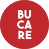
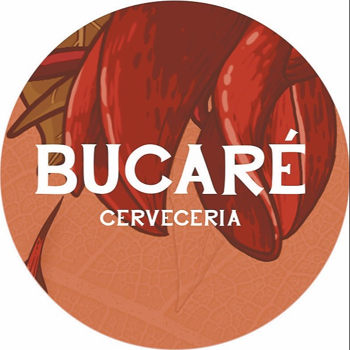
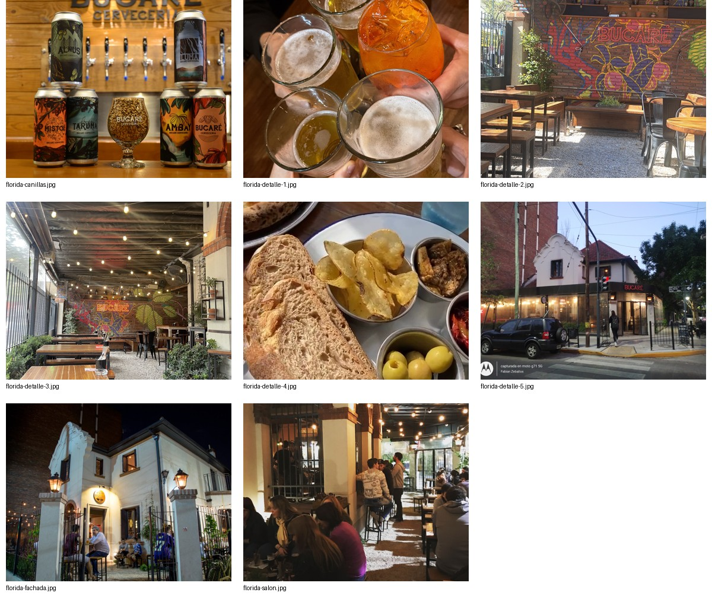

# Bucaré: manual de marca adaptado y 12 direcciones visuales

**Versión de trabajo 1.0 · 02/11/2026 · Propuesta pendiente de aprobación.** Este documento no se presenta como el manual oficial de la cervecería. Distingue identidad publicada, mediciones aproximadas y reglas nuevas recomendadas.

## 1. El sistema que existe

### A. Avatar actual de Instagram

Archivo recuperado de `og:image` en el HTML público de Instagram: JPEG de **100 × 100 px**, círculo rojo, letras blancas sans serif en tres líneas **BU / CA / RÉ**. El acento de RÉ forma parte de la identificación. Fuente tipográfica exacta, construcción geométrica original y especificaciones cromáticas: no disponibles.

Es el punto de partida actual **en la fuente consultada**. No se infiere cuándo se adoptó ni si tiene exclusividad de uso. No agrandar este JPEG para impresos o carteles; solicitar el vector original. Un PNG obtenido de este JPEG tampoco recupera calidad vectorial.

### B. Avatar publicado en Linktree

JPEG de **598 × 599 px**: círculo ilustrado con motivos botánicos rojos y fondo cálido, **BUCARÉ** y **CERVECERIA** en blanco con serif. No es el avatar actual descargado de Instagram. Puede ser una versión histórica, alternativa o de producto; su vigencia requiere aprobación.

### C. Marca observada en las piezas y el local

Las cartas usan Bucaré y Bucafé, mayormente negro sobre blanco. Las promociones combinan logotipo serif blanco, títulos grandes, fotos y marcas dibujadas. Las latas y el mural de Florida usan ilustración botánica y múltiples colores. Hay distintas formas de señalética en las fotos históricas.

**Diagnóstico:** existen varias expresiones de marca. Antes de unificar, preguntar al titular cuál es la firma principal, qué versiones pertenecen a producto y cuáles son anteriores. No borrar el mundo ilustrado ni asignar al logo rojo una tipografía inventada como si fuera oficial.

## 2. Estrategia propuesta

**Idea rectora:** Bucaré como lugar de encuentro con cerveza y cocina, con una oferta diurna real en Bucafé. Es una interpretación apoyada en la carta y las fotos, no una misión empresarial publicada.

**Personalidad recomendada:** cercana, clara, sociable, segura del producto y con carácter local. Evitar tanto el lujo impostado como el cliché de cervecería de fábrica que desconozca la casa y el patio de Florida.

**Territorios apoyados por evidencia:** cerveza; comida para compartir; tres sucursales; cafetería; universo gráfico botánico. «Familiar», «pet friendly», «artesanal de elaboración propia», premios, historia y accesibilidad necesitan validación antes de usarse como atributos comerciales.

**Arquitectura propuesta:** una marca madre Bucaré; tres identificadores de sucursal; Bucafé como línea de carta. Mantener las equivalencias Florida/BucaFlori, Olivos/BrewPub y Tren/BucaTren, sin crear una cuarta ubicación.

## 3. Uso del logo: reglas recomendadas

Estas medidas son propuestas, no medidas tomadas del archivo maestro.

| Regla | Recomendación |
| --- | --- |
| Firma principal | Avatar rojo actual de Instagram, hasta confirmación del titular |
| Reserva de espacio | Al menos 1/4 del diámetro del círculo libre alrededor |
| Tamaño digital mínimo | 40 px de diámetro para mantener las tres líneas reconocibles; usar 48-64 px en cabecera |
| Límite del archivo recuperado | No exceder 100 px a escala 1x; para pantallas densas o tamaño mayor, pedir vector/exportación nueva |
| Impresión | Determinar mínimo tras recibir vector y hacer prueba física; no aprobar impresión con el JPEG de 100 px |
| Fondos | Preferir neutros. Si una foto dificulta el borde o letras, colocar la firma en zona limpia con reserva de espacio |
| Versiones monocromas | Sólo producir desde el vector aprobado; las exploraciones tipográficas no equivalen a versión oficial |
| Relación con nombre de sucursal | Sucursal como texto separado, nunca dentro del círculo ni sustituyendo ninguna línea del nombre |
| Convivencia | Una firma principal por pieza; no juntar ambos avatars como doble logotipo excepto al compararlos en documentación |
| Nombre escrito | «Bucaré» en texto corriente; «BUCARÉ» en títulos. Conservar acento. «Bucafé» cuando se refiera a esa línea |

**Usos incorrectos:** estirar, inclinar, quitar el acento, reordenar las tres líneas, cubrir las letras, añadir sombra al archivo, pegar un círculo rojo de color distinto debajo del JPEG, sustituir tipografía y llamarlo original, convertir ilustración secundaria en firma principal sin aprobación.

Las propuestas usan el archivo publicado. El título «Bucaré» con otra tipografía es una **composición editorial**, no una reconstrucción exacta del logo.

## 4. Color: observado, medido y propuesto

### Base roja de Instagram

| Muestra | Valor RGB aproximado | Estado |
| --- | --- | --- |
| Rojo dominante | `#C1282D` | Cuantización del JPEG público, no color corporativo oficial |
| Blanco | `#FFFFFF` | Recomendado para el sistema; el JPEG produce blancos cercanos a `#FDFBFA` |
| Variaciones de compresión | `#B7252B`, `#C2262D`, `#C64D51` | No convertir en colores adicionales de marca |

Método: cuantización adaptativa Pillow a cinco colores. El blanco exterior al círculo y los bordes suavizados alteran las proporciones. No inferir porcentaje de uso recomendado de la proporción de píxeles. [Medición guardada](../investigacion/paleta-instagram.json).

### Paleta ilustrada de Linktree

| Muestra | Valor aproximado | Uso posible, no oficial |
| --- | --- | --- |
| Terracota | `#CF7550` | Fondo/ilustración de la versión publicada |
| Rojo botánico | `#A53324` | Ilustración |
| Rojo oscuro | `#7B3026` | Sombras ilustradas |
| Blanco de archivo | `#FEFEFE` | Letras y exterior |

[Medición completa a 12 colores](../investigacion/paleta-muestreada.json). La ilustración no está formada necesariamente por tintas planas; estos valores no autorizan recolorear etiquetas.

### Sistema recomendado para la primera web

| Rol | Color propuesto | Uso |
| --- | --- | --- |
| Firma | `#C1282D` | Identificación, acentos y acción principal con texto blanco |
| Fondo | `#FFFFFF` | Carta, contenido y áreas de lectura |
| Texto | `#202420` | Texto principal sobre fondo claro |
| Contrapunto | `#233D32` | Títulos secundarios y relación visual con mural/patio |
| Superficie | `#E2E6E1` | Separadores, fondos funcionales y estados neutros |
| Acento limitado | `#D3EA60` | Señales o piezas especiales con texto oscuro; no reemplazar la firma roja |

Reparto orientativo: 65 % blanco/áreas de foto, 20 % texto y estructura, 10 % rojo, 5 % contrapuntos. No es una fórmula para teñir fotos. El rojo domina sólo en la dirección 01 o campañas; las demás equilibran color con blanco, negro y fotografía.

**No hay CMYK, Pantone o RAL oficial recuperado.** No convertir HEX a una tinta supuestamente exacta. Para imprenta: perfil ICC del proveedor, prueba de color y aprobación del titular. RGB/HEX sirve para prototipos de pantalla.

## 5. Contraste y legibilidad

Requisito propuesto: WCAG 2.2 AA, **4,5:1** en texto normal y **3:1** en texto grande y elementos de interfaz esenciales. Medir los pares finales, incluidos estados hover, foco y deshabilitado cuando corresponda. El avatar original es un activo de marca; los títulos, botones y textos de la web no quedan exentos de legibilidad.

- Blanco sobre rojo `#C1282D`, carbón `#202420` sobre blanco y blanco sobre verde `#233D32` son pares de base a comprobar en la exportación final.
- Amarillo, lima y rosa deben llevar texto oscuro cuando el blanco no alcance contraste.
- No usar color como único indicador de vegetariano, sucursal, error o estado de reserva.
- Fotos: conservar exposición natural y elegir una zona vacía para títulos; si se necesita oscurecer toda la foto para leer, cambiar la composición. No tapar el producto con texto.
- Los mockups son exploratorios; los fondos fotográficos necesitan medición y ajuste por imagen antes de convertirse en web de producción.

## 6. Tipografía

**No se identificó la fuente exacta de ninguno de los logos originales.** Las siguientes son tipografías de apoyo propuestas y disponibles localmente con sus licencias.

| Familia | Papel recomendado | Direcciones |
| --- | --- | --- |
| Archivo Black | Marca editorial potente y afiche | 01 y tratamiento apilado |
| Space Grotesk | Cabeceras y sistema funcional | 07, 12 y tratamiento horizontal |
| DM Sans | Cuerpo, precios, navegación y botones | Sistema transversal |
| Instrument Serif | Titulares editoriales cálidos, no cuerpo de carta | 02, 10 |
| Fraunces | Patio, cafetería y edición botánica | 04, 08, 11 |
| Barlow Condensed | Carteles y fichas de cerveza | 03, 05 |
| Bodoni Moda | Exploración gastronómica contrastada | 06 |
| IBM Plex Mono | Datos breves, numeración y señalética | 05, 07; no párrafos extensos |
| Bricolage Grotesque | Exploración expresiva y catálogo | 09 |

**Escala de interfaz propuesta:** cuerpo 16 px, secundario 14 px, nota 12 px, H3 24 px, H2 32 px, H1 56-72 px en una composición principal amplia. En paneles y documentos usar 24-38 px, no escala de hero. En celular definir escalones estables de 40-48 px para el título principal y 24-28 px para secciones; no escalar por `vw`.

Interlineado: 1,45-1,6 para lectura y 1-1,15 para display. Espaciado de letras: 0. Usar negrita real y números alineados para precios, no columnas hechas con espacios en la carta web.

## 7. Fotografía y dirección de arte

### Material existente

Ocho fotos públicas de Florida, avatars y tres láminas de promociones. Hay fotos de latas, patio, fachada, brindis y un plato histórico no identificado. No se descargaron fotos de los otros dos locales ni una colección gastronómica completa.

### Nueva sesión recomendada

- Cada sucursal: fachada con marca legible, entrada, salón/patio, barra, mesas y una imagen horizontal para web.
- Producto: cada lata de frente y cada cerveza servida con su etiqueta correspondiente, sin inferir estilo por el color de la bebida.
- Cocina: platos vigentes identificados con la carta; fotos de pizzas, papas, nachos, hamburguesas y opciones vegetarianas reales.
- Bucafé: bebida caliente, tostadas, dulce y combo completo, con presentación real.
- Encuentro: manos y mesa, con permiso de las personas; no usar clientes identificables sin autorización.

Color natural, textura presente, iluminación agradable y producto inspeccionable. No filtros sepia, negros empastados, desenfoque del plato principal ni recortes que impidan reconocer el local. Versiones 3:2 y 4:5; dejar espacio de composición sin esconder el sujeto. Exportar WebP/AVIF cuando proceda y guardar originales.

No usar fotos de YAAS, Tòpas, Henrietta u otros negocios como si fueran de Bucaré. Las capturas de referencia son para análisis. La presencia pública de una imagen no equivale a licencia comercial; confirmar derechos o producir material propio.

## 8. Recursos gráficos e iconografía

La ilustración botánica de las latas y el mural son los recursos más específicos del local. Se recomienda recuperar sus originales con autorización y usarlos en límites de sección, etiquetas o piezas de campaña, **no encima del texto de la carta**.

No asumir especie botánica, origen del nombre ni relato histórico sin fuente. No crear un nuevo escudo de lúpulo, tanque o tren y presentarlo como identidad existente.

Interfaz: iconos Lucide para herramientas, flechas, enlaces y acciones; nombres accesibles y tooltips en botones sin texto. Checkbox/toggle para estados, selector para sucursal, tabs para categorías y botones con texto para comandos como reservar. Radios y esquinas moderados: 4-8 px en componentes, sin secciones enteras convertidas en tarjetas.

## 9. Voz y textos

**Tono propuesto:** español rioplatense claro, cercano y sin falsas promesas. Voseo si la marca lo aprueba. Dar prioridad al dato que permite decidir.

| Situación | Texto propuesto | Evitar |
| --- | --- | --- |
| Marca y categoría | «Bucaré · Cervecería y cocina» | «La mejor cerveza del país» sin respaldo |
| Reservas | «Reservar en Florida» | «Reserva confirmada» por abrir WhatsApp |
| Carta | «Carta de Olivos / Brew Pub» | «Ver menú» sin indicar sucursal |
| Happy hour | «Todos los días, de 18 a 20 h» y beneficio validado | «2x1» inventado |
| Cafetería | «Bucafé · Café, dulce y salado» | «Abierto desde las 10» inferido de una oferta |
| No informado | Omitir o «Consultar» en un flujo aprobado | Precio cero o stock inventado |

«Birra. Cocina. Bucaré.», «Una mesa en Bucaré», «La casa de la próxima ronda» y las demás frases del catálogo son **propuestas de copy**, no eslóganes recuperados. No deducir efectos saludables de opiniones o del término sin alcohol. La comunicación de alcohol no debe dirigirse a menores ni prometer seguridad al conducir.

## 10. Doce direcciones para elegir

Las paletas de esta sección son propuestas deliberadamente distintas. Todas mantienen el avatar de Instagram, excepto 11, que explora la versión ilustrada como recurso secundario sujeto a aprobación. Las composiciones se pueden ver en [Catálogo visual](../propuestas/index.html).

### 01. Rojo de origen

**Paleta:** `#C1282D` · `#FFFFFF` · `#202420` · `#FFE172` · `#E9EDE8`. **Tipos:** Archivo Black + DM Sans. Bloque rojo, título compacto y foto de latas. Conserva al máximo la señal actual de Instagram. Aplicaciones: inicio, carta y promos. Esfuerzo bajo. Riesgo: saturación roja. Referencia: Tòpas por estructura gráfica, no por copiar identidad. **Selección inicial.**

### 02. Editorial de barrio

**Paleta:** `#FFFFFF` · `#242424` · `#C1282D` · `#536B5A` · `#E9EDF0`. **Tipos:** Instrument Serif + DM Sans. Centro editorial, divisores finos y fotografía de fachada; círculo rojo como firma. Aplicaciones: restaurante y menú. Esfuerzo bajo. Riesgo: parecer demasiado sobrio sin cerveza visible. Referencias: STILL / FORM y Hozon. **Selección inicial.**

### 03. Afiche cervecero

**Paleta:** `#FFE172` · `#C1282D` · `#21231E` · `#FFFFFF` · `#2D7E83`. **Tipos:** Barlow Condensed + DM Sans. Afiche con horario grande y borde rojo de producto. Aplicaciones: happy hour y campañas. Esfuerzo medio. Riesgo: gritar en todas las secciones; reservar expresividad para ofertas. Referencia: Tòpas.

### 04. Patio abierto

**Paleta:** `#245B46` · `#FFFFFF` · `#C1282D` · `#F3C5C8` · `#E4CB69`. **Tipos:** Fraunces + DM Sans. Foto del patio protagonista, banda verde y pie rosa. Aplicaciones: reservas y sucursales. Esfuerzo medio. Riesgo: extender imágenes de Florida a otras sedes. Referencia: STILL / FORM. **Selección inicial.**

### 05. Canilla técnica

**Paleta:** `#202420` · `#F6F8F5` · `#D3EA60` · `#C1282D` · `#9FAAA1`. **Tipos:** Barlow Condensed + IBM Plex Mono. Numeración, datos técnicos y latas visibles; carbón con lima. Aplicaciones: cervezas y packs. Esfuerzo medio. Riesgo: un lenguaje frío para Bucafé. Referencia: YAAS por producto protagonista, no por sus claims.

### 06. Mesa contemporánea

**Paleta:** `#F5F6F3` · `#242B29` · `#C1282D` · `#4E8171` · `#CEDFE9`. **Tipos:** Bodoni Moda + DM Sans. Serif gastronómica, composición centrada y plato visible. Aplicaciones: cocina y carta impresa. Esfuerzo medio. Riesgo: requiere fotos de platos actuales; la muestra histórica no identifica un producto vigente. Referencias: Hozon y Mâm Cơm.

### 07. Tres estaciones

**Paleta:** `#2454A4` · `#FFFFFF` · `#C1282D` · `#F3D96A` · `#DDE3E9`. **Tipos:** Space Grotesk + IBM Plex Mono. Señalética, nombres de sucursal y orientación; azul como exploración explícita. Aplicaciones: elegir local y llegar. Esfuerzo medio. Riesgo: alejarse de la marca actual; no inventar arquitectura ferroviaria. Referencia: STILL / FORM por navegación espacial.

### 08. El lado Bucafé

**Paleta:** `#D8EFE8` · `#263D32` · `#C1282D` · `#FFFFFF` · `#F2B6BC`. **Tipos:** Fraunces + DM Sans. Verde menta, coral y composición diurna. Aplicaciones: desayunos, meriendas y ejecutivo. Esfuerzo bajo. Riesgo: ocultar cerveza si se aplica a toda la marca. Referencia: Hozon. Recomendado como sublínea, no como identidad madre.

### 09. Circuito de latas

**Paleta:** `#E9F272` · `#212620` · `#C1282D` · `#F6BFCB` · `#367A87`. **Tipos:** Bricolage Grotesque + DM Sans. Bloques ligeramente girados, lima/rosa y etiquetas reales. Aplicaciones: packs y campañas. Esfuerzo alto. Riesgo: animación y colores pueden competir con el producto. Referencias: YAAS y Henrietta; sin copiar sus personajes, textos ni activos.

### 10. Casa y sobremesa

**Paleta:** `#FFFFFF` · `#233D32` · `#C1282D` · `#D8E3DC` · `#F4CE71`. **Tipos:** Instrument Serif + DM Sans. Fachada reconocible, título sobre zona adecuada y franja de reservas/carta. Aplicaciones: inicio y páginas del local. Esfuerzo medio. Riesgo: requiere una imagen propia equivalente de cada sede. Referencias: STILL / FORM y Mâm Cơm por lugar y encuentro. **Selección inicial.**

### 11. Archivo botánico

**Paleta:** `#234E3F` · `#FFFFFF` · `#A53324` · `#E7C764` · `#CF7550`. **Tipos:** Fraunces + DM Sans. Mural e ilustración como hilo conductor. Explora el avatar ilustrado de Linktree, claramente identificado. Aplicaciones: etiquetas y edición especial. Esfuerzo alto. Riesgo: no asumir vigencia del avatar ilustrado. Referencia: Mâm Cơm por coherencia simbólica, no por iconografía vietnamita.

### 12. Esencial Bucaré

**Paleta:** `#FFFFFF` · `#202420` · `#C1282D` · `#E2E6E1` · `#D3EA60`. **Tipos:** Space Grotesk + DM Sans. Blanco y rojo, grilla compacta, carta y reserva directas, fotos reales. Aplicaciones: primera web propia de fácil mantenimiento. Esfuerzo bajo. Riesgo: menor espectacularidad; depende de foto de calidad. Referencia: Hozon por claridad funcional. **Selección inicial y recomendación para primera entrega web.**

## 11. Seis tratamientos tipográficos exploratorios

Además de las 12 direcciones, el catálogo muestra apilado sans, horizontal sans, editorial serif, sello tipográfico, condensado de afiche y rótulo Bucafé. Son opciones de composición para discutir jerarquía y personalidad. **No son seis nuevos logos oficiales ni una vectorización de los originales.** Si se elige uno como nuevo logotipo, abrir una fase específica de diseño, dibujo, pruebas de tamaño, registro y aprobación.

## 12. Aplicaciones propuestas

| Pieza | Reglas de composición |
| --- | --- |
| Web principal | Marca y local/producto visibles en primer viewport; elegir sucursal, carta y reservar como tareas principales |
| Carta web | Texto legible, categoría y precio alineados, notas de dieta escritas; no depender del PDF como única interfaz |
| Carta impresa | Información por sucursal, fecha de versión, jerarquía y precios claros; original vectorial para firma |
| Promociones | Beneficio exacto, horario, vigencia y condiciones; no anunciar supuestos descuentos |
| Perfil social | Avatar rojo original o versión aprobada exportada a tamaño correcto |
| Historias y feed | Plantilla de promoción y plantilla fotográfica; texto útil lejos de zonas tapadas por controles de la plataforma |
| Latas / packaging | Conservar diseño vigente; no recolorear o reemplazar sin originales y aprobación |
| Cartelería | Identificación principal, legibilidad a distancia y datos mínimos; probar físicamente |
| QR de mesa | Generar al existir dominio definitivo; destino propio estable a la carta del local; no crear QR ficticio |

## 13. Movimiento, accesibilidad y rendimiento

Sin intro obligatoria, música automática, cursor decorativo que sustituya al cursor normal ni scroll secuestrado. Animación corta sólo si no retrasa carta o reserva; respetar `prefers-reduced-motion`. Interacciones siempre posibles con teclado, foco visible, nombres accesibles y dimensiones táctiles adecuadas.

Preferir foto estática buena antes que 3D o video pesado. Si en una fase posterior se incorpora un carrusel de estilos, usar controles y lista alternativa. No hace falta una escena Three.js para sustituir Linktree. Tipografías e iconos del catálogo están alojados localmente; la futura web también debe optimizar imágenes y limitar pesos.

## 14. Criterio de elección

Para primera web, escoger **12** si pesan mantenimiento y rapidez de consulta; **01** si la continuidad roja y el carácter son prioritarios; **02** si se quiere elevar el costado gastronómico; **04 o 10** si la experiencia del lugar conduce la comunicación. **08** funciona como complemento de Bucafé. **03 y 09** como campañas, no necesariamente como todo el sitio.

No mezclar arbitrariamente las doce paletas. Elegir una dirección madre, una tipografía display, una de texto y reglas comunes. Evaluar con clientes reales en celular: encontrar una carta, elegir sucursal y llegar al WhatsApp correcto. Las favoritas del catálogo son una ayuda de selección, no una aprobación automática.

## 15. Aprobación y archivos maestros pendientes

1. Confirmar versión principal y vigencia de la versión ilustrada.
2. Obtener SVG/PDF/AI original y exportaciones correctas.
3. Aprobar paleta y familias de apoyo; el muestreo JPEG no sustituye aprobación.
4. Obtener fotos actuales y derechos de uso, incluidos mural y etiquetas.
5. Confirmar todos los datos comerciales del informe.
6. Elegir una dirección y cerrar aplicaciones finales; entonces exportar manual oficial, tokens de diseño y originales.

Las fuentes descargadas provienen de paquetes Fontsource, con licencias conservadas en la entrega. Los iconos son Lucide, con licencia conservada. Los logos y fotos de Bucaré mantienen los derechos de sus titulares: el archivado de investigación no modifica esos derechos.